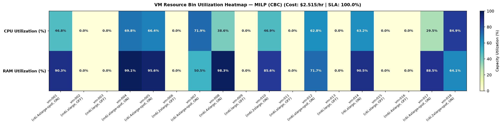
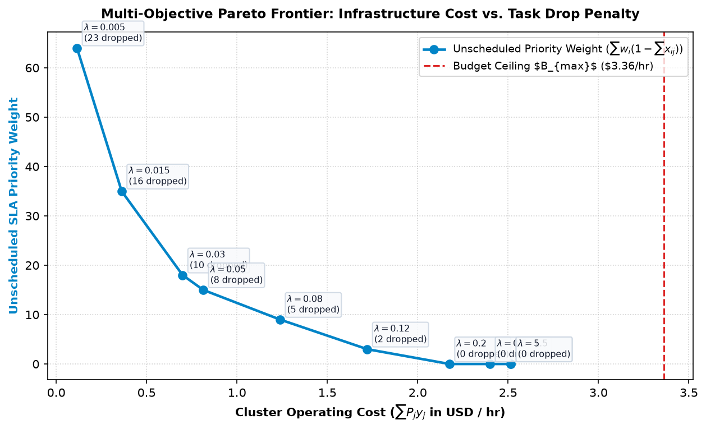

# ☁️ Cloud Optimizer — MILP & Multi-Dimensional Knapsack Scheduler for Containerized Cloud Workloads

[](https://www.python.org/downloads/)
[](https://github.com/coin-or/pulp)
[](https://docs.pydantic.dev/)
[](https://docs.pytest.org/)
[](https://opensource.org/licenses/MIT)

`cloud_optimizer` is a production-ready **Operations Research** and **Cloud FinOps** Python package that solves a **Multi-Dimensional Knapsack** and **Mixed-Integer Linear Programming (MILP)** problem for scheduling containerized compute workloads (Kubernetes pods, batch jobs, burst traffic, microservices) onto heterogeneous cloud Virtual Machine (VM) instances (Spot & On-Demand).

It jointly minimizes **hourly cloud infrastructure spend ($/hr)** and **SLA task-drop penalties**, while strictly enforcing multi-dimensional node capacities (CPU & RAM) and hard cluster budget ceilings.

---

## 🎯 Key Features

- **Exact MILP Optimization (`solver.py`):** Formulates the multi-dimensional bin-packing and knapsack allocation problem using `PuLP` and the **COIN-OR CBC** branch-and-cut solver, warm-started with a greedy incumbent for rapid convergence at scale.
- **Strict Schema Validation (`models.py`):** Built on **Pydantic v2** with strict domain invariants ($w_i \in [1, 5]$, $q_j \in (0, 1]$, unique IDs, non-negative capacities and budgets).
- **Synthetic Cloud Workload & Fleet Generator (`generator.py`):** Generates realistic cloud workloads (`batch`, `burst`, and `microservice` profiles) and heterogeneous EC2-style instance fleets (`m6i`, `c6i`, `r6i` across **On-Demand** and **Spot** pricing tiers).
- **Multi-Scale Heuristic Benchmarking (`benchmark.py`):** Evaluates the MILP solution against industry-standard baseline schedulers (**First-Fit Decreasing (FFD)** and **Random Round-Robin**) across scales $N \in \{20, 50, 200, 1000\}$ on cost savings ($), CPU/RAM bin utilization (%), SLA compliance (%), and runtime.
- **Diagnostic Visualizations (`visualizer.py`):** Generates publication-quality Matplotlib figures:
  1. **2D Bin Utilization Heatmaps** (CPU & RAM packing density per active/inactive VM).
  2. **Multi-Objective Pareto Frontier** tracing the trade-off between hourly infrastructure spend ($) and unscheduled SLA priority weight across $\lambda$ penalty sweeps.
- **Production CLI (`cli.py`) & Test Suite (`tests/test_scheduler.py`):** Clean `argparse` CLI (`solve`, `benchmark`, `visualize`) and comprehensive `pytest` verification of all mathematical constraints.

---

## 📐 Mathematical Formulation

### 1. Sets & Parameters
- **Tasks:** $i \in \mathcal{I} = \{1, \dots, N\}$
  - $c_i > 0$: CPU request (vCPUs)
  - $r_i > 0$: Memory request (GiB)
  - $w_i \in \{1, 2, 3, 4, 5\}$: SLA priority weight
  - $d_i > 0$: Execution deadline (hours)
- **Virtual Machines:** $j \in \mathcal{J} = \{1, \dots, M\}$
  - $C_j > 0$: Total CPU capacity (vCPUs)
  - $R_j > 0$: Total RAM capacity (GiB)
  - $P_j \ge 0$: Hourly operating cost ($\text{USD/hr}$)
  - $q_j \in (0, 1]$: Instance availability / reliability probability
- **Global Hyperparameters:**
  - $B_{\max} \ge 0$: Maximum hourly cluster budget ceiling ($\text{USD/hr}$)
  - $\lambda \ge 0$: Penalty scaling factor balancing infrastructure cost against SLA task drops

### 2. Decision Variables
- $x_{ij} \in \{0, 1\} \quad \forall i \in \mathcal{I}, \; \forall j \in \mathcal{J}$: Binary variable equal to $1$ if task $i$ is assigned to VM $j$, and $0$ otherwise.
- $y_j \in \{0, 1\} \quad \forall j \in \mathcal{J}$: Binary variable equal to $1$ if VM $j$ is provisioned (turned ON), and $0$ otherwise.

### 3. Objective Function
Minimize total hourly VM operating cost plus the $\lambda$-weighted penalty of unscheduled tasks:

$$\min_{x, y} \quad \sum_{j=1}^{M} P_j \cdot y_j + \lambda \sum_{i=1}^{N} w_i \left(1 - \sum_{j=1}^{M} x_{ij}\right)$$

### 4. Constraints
1. **Single Assignment (Each task scheduled at most once):**
   $$\sum_{j=1}^{M} x_{ij} \le 1 \quad \forall i \in \{1, \dots, N\}$$
2. **Machine CPU Capacity & Activation Coupling:**
   $$\sum_{i=1}^{N} c_i \cdot x_{ij} \le C_j \cdot y_j \quad \forall j \in \{1, \dots, M\}$$
3. **Machine RAM Capacity & Activation Coupling:**
   $$\sum_{i=1}^{N} r_i \cdot x_{ij} \le R_j \cdot y_j \quad \forall j \in \{1, \dots, M\}$$
4. **Total Cluster Budget Ceiling:**
   $$\sum_{j=1}^{M} P_j \cdot y_j \le B_{\max}$$

---

## 🗂️ Repository Architecture

```text
cloud_optimizer/
├── pyproject.toml                  # PEP 621 package metadata, dependencies & CLI entry point
├── README.md                       # Project documentation & mathematical specification
├── artifacts/                      # Generated diagnostic visualizations
│   ├── bin_utilization_heatmap.png
│   └── pareto_frontier.png
├── src/
│   └── cloud_optimizer/
│       ├── __init__.py             # Public package exports
│       ├── models.py               # Pydantic v2 schemas: Task, VirtualMachine, ClusterConfig, OptimizationResult
│       ├── generator.py            # Synthetic workload & Spot/On-Demand fleet generator
│       ├── solver.py               # CloudTaskScheduler MILP solver (build_model, solve, get_allocation_summary)
│       ├── benchmark.py            # MILP vs. First-Fit Decreasing (FFD) & Random Round-Robin benchmark suite
│       ├── visualizer.py           # Matplotlib bin utilization heatmaps & Pareto frontier curves
│       └── cli.py                  # Command-line interface (solve, benchmark, visualize)
└── tests/
    └── test_scheduler.py           # Unit tests verifying capacity, budget, and binary integrality constraints
```

---

## 🚀 Installation & Quick Start

### 1. Clone & Install
```bash
git clone https://github.com/saifabdesmad/Cloud-Optimizer.git
cd Cloud-Optimizer

# Install package in editable mode with test dependencies
pip install -e ".[dev]"
```

### 2. CLI Usage

#### Solve a Synthetic Cluster Instance
```bash
cloud-optimizer solve --num-tasks 40 --budget-tightness 0.75 --lambda-penalty 5.0 --output-json artifacts/summary.json
```

#### Run Multi-Scale Comparative Benchmarks ($N = 20, 50, 200, 1000$)
```bash
cloud-optimizer benchmark --scales 20 50 200 1000 --time-limit 15.0
```

#### Generate Diagnostic Visualizations
```bash
cloud-optimizer visualize --num-tasks 30 --output-dir artifacts
```

### 3. Python API Usage
```python
from cloud_optimizer import WorkloadGenerator, CloudTaskScheduler, ScheduleVisualizer

# 1. Generate realistic synthetic tasks and heterogeneous Spot/On-Demand VMs
gen = WorkloadGenerator(seed=42)
config = gen.generate_cluster_config(
    num_tasks=50,
    budget_tightness=0.75,
    lambda_penalty=5.0,
    solver_time_limit=20.0,
)

# 2. Build and solve the MILP model
scheduler = CloudTaskScheduler(config)
scheduler.build_model()
result = scheduler.solve(msg=False)

# 3. Inspect structured summary
summary = scheduler.get_allocation_summary()
print(f"Status: {summary['status']} | Cost: ${summary['total_operating_cost_usd']}/hr | SLA: {summary['sla_compliance_pct']}%")

# 4. Generate plots
ScheduleVisualizer.plot_bin_utilization_heatmap(result, "artifacts/bin_utilization_heatmap.png")
ScheduleVisualizer.plot_pareto_frontier(config, "artifacts/pareto_frontier.png")
```

---

## 📊 Empirical Benchmark Results & Visualizations

Comparing **MILP (CBC)** against **First-Fit Decreasing (FFD)** and **Random Round-Robin** demonstrates substantial cost reductions and higher bin-packing density:

| $N$ (Tasks) | $M$ (VMs) | Strategy | Objective Value | VM Cost (\$/hr) | Cost Diff vs. MILP (\$) | Cluster CPU Util (%) | Cluster RAM Util (%) | SLA Compliance (%) | Runtime (s) |
| :---: | :---: | :--- | :---: | :---: | :---: | :---: | :---: | :---: | :---: |
| **20** | 12 | **MILP (CBC)** | **0.987** | **$0.9866** | **$0.0000** | **91.43%** | **84.61%** | **100.00%** | 0.14s |
| **20** | 12 | First-Fit Decreasing | 1.869 | $1.8690 | +$0.8824 (+89.4%) | 67.05% | 57.89% | 100.00% | <0.01s |
| **20** | 12 | Random Round-Robin | 2.596 | $2.5962 | +$1.6096 (+163.1%) | 54.36% | 48.88% | 100.00% | <0.01s |
| **50** | 28 | **MILP (CBC)** | **3.442** | **$3.4423** | **$0.0000** | **87.43%** | **80.89%** | **100.00%** | 0.41s |
| **50** | 28 | First-Fit Decreasing | 4.239 | $4.2391 | +$0.7968 (+23.1%) | 82.94% | 60.67% | 100.00% | <0.01s |
| **50** | 28 | Random Round-Robin | 15.523 | $5.5233 | +$2.0810 (+60.5%) | 67.07% | 56.58% | 98.73% | <0.01s |

### VM Resource Bin Utilization Heatmap


### Cost vs. Task Drop Penalty Pareto Frontier


---

## 🧪 Running Unit Tests

All mathematical constraints—binary variable integrity ($x_{ij}, y_j \in \{0, 1\}$), single task assignment, CPU/RAM capacity ceilings, hard budget limits ($B_{\max}$), and priority-weighted selection under contention—are verified via `pytest`:

```bash
pytest
```
